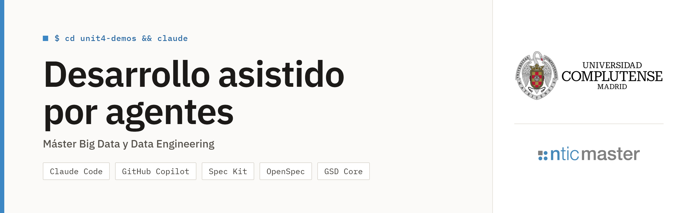

# Ejemplos prácticos del módulo

Ejemplos y demos de la asignatura **Desarrollo asistido por agentes**, agrupados por unidad. Cada carpeta tiene su
propio README con el detalle de los ejemplos que contiene.

| Carpeta | Contenido |
|---|---|
| [unit2-demos](unit2-demos/README.md) | Caveman en GitHub Copilot y *function calling* con la API de Claude |
| [unit3-demos](unit3-demos/README.md) | Seis demos cortas sobre los riesgos del desarrollo asistido por IA |
| [unit4-demos](unit4-demos/README.md) | Dos proyectos de datos para trabajar con Claude Code: Hoteles Brisa y Pedalia |
| [unit5-demos](unit5-demos/README.md) | Desarrollo guiado por especificaciones con Spec Kit, OpenSpec y GSD Core |

## Cómo usar este repositorio

Clona el repositorio una vez:

```bash
git clone https://github.com/mrcabellom/ejemplos-practicos-master.git
```

Cada ejemplo es un proyecto independiente: tiene sus propias dependencias y sus propias instrucciones. Abre en el
IDE o en el asistente de código **la carpeta del ejemplo**, no la raíz del repositorio. Así el asistente encuentra la
configuración del ejemplo (`.claude/`, `.github/`, `AGENTS.md`...) y el entorno de Python correcto.

Los ejemplos de las unidades 4 y 5 trabajan con ramas, commits y worktrees. Para no mezclar ese historial con el de
este repositorio, cada README explica cómo copiar el ejemplo a otra carpeta e inicializar allí un repositorio Git
propio.

---

## Instalación

Todos los ejemplos necesitan **Git** y **uv**. Algunos ejemplos de la unidad 5 necesitan además **Node.js**. Python
no hace falta instalarlo por separado: uv descarga la versión que fija cada ejemplo en su `.python-version` (3.12).

| Herramienta | Para qué | Comprobación |
|---|---|---|
| Git | Clonar el repositorio y trabajar con ramas y commits | `git --version` |
| uv | Instalar Python, crear los entornos virtuales y ejecutar los ejemplos | `uv --version` |
| Node.js (LTS, 24 o superior) | Instalar OpenSpec y GSD Core con npm | `node --version` y `npm --version` |

Después de instalar cada herramienta, **cierra y vuelve a abrir el terminal** para que reconozca los nuevos
comandos.

### Git

**Windows** (PowerShell):

```powershell
winget install --id Git.Git -e --source winget
```

El instalador incluye Git Bash, un terminal con los mismos comandos que macOS y Linux.

**macOS:** Git viene con las herramientas de línea de comandos de Xcode. Si `git --version` no responde, instálalas:

```bash
xcode-select --install
```

También puede instalarse con [Homebrew](https://brew.sh/):

```bash
brew install git
```

**Linux** (Debian y Ubuntu):

```bash
sudo apt update && sudo apt install git
```

En Fedora: `sudo dnf install git`.

Configura tu nombre y tu correo la primera vez, porque los ejemplos hacen commits:

```bash
git config --global user.name "Tu nombre"
```

```bash
git config --global user.email "tu@correo.com"
```

### uv

**Windows** (PowerShell):

```powershell
powershell -ExecutionPolicy ByPass -c "irm https://astral.sh/uv/install.ps1 | iex"
```

O con winget: `winget install --id astral-sh.uv -e`.

**macOS y Linux:**

```bash
curl -LsSf https://astral.sh/uv/install.sh | sh
```

En macOS también puede instalarse con Homebrew: `brew install uv`.

Para comprobar que uv puede descargar Python:

```bash
uv python install 3.12
```

### Node.js

Solo lo necesitan los ejemplos de [OpenSpec](unit5-demos/openspec/README.md) y [GSD Core](unit5-demos/gsd-core/README.md).
Instala la versión **LTS**, que incluye npm.

**Windows** (PowerShell):

```powershell
winget install OpenJS.NodeJS.LTS
```

**macOS** (con Homebrew):

```bash
brew install node
```

**Linux** (también válido en macOS): con [nvm](https://github.com/nvm-sh/nvm), que instala Node.js en el usuario
actual sin necesidad de `sudo`. Instala nvm según las instrucciones de su README y, a continuación, ejecuta:

```bash
nvm install --lts
```

En los tres sistemas también puede descargarse el instalador desde [nodejs.org](https://nodejs.org/).

### Asistente de código

Cada ejemplo indica qué asistente utiliza. La mayoría usa **Claude Code** (CLI, aplicación de escritorio o extensión
del IDE). El ejemplo de Caveman usa **GitHub Copilot**, y el de Hoteles Brisa incluye también la configuración para
GitHub Copilot, Cursor y OpenCode. Las instrucciones de instalación están en la documentación de
[Claude Code](https://docs.claude.com/en/docs/claude-code/setup) y de [GitHub Copilot](https://docs.github.com/en/copilot).

### Editor

Los ejemplos pueden abrirse con cualquier IDE o editor. Recomendamos **Visual Studio Code**, porque tiene extensiones
para Claude Code, GitHub Copilot, Python y bases de datos.

Descarga el instalador para Windows, macOS o Linux desde la página oficial:
[code.visualstudio.com/download](https://code.visualstudio.com/download).

Extensiones recomendadas: **Python** (Microsoft), **Claude Code** (Anthropic) y **GitHub Copilot Chat** (GitHub).

### Visores de bases de datos (opcional)

Algunos ejemplos guardan sus datos en **SQLite** (`warehouse.db` en Hoteles Brisa y la base de datos de citas de
Kinesia) o en **DuckDB** (`warehouse.duckdb` en La Despensa y `warehouse/mercaluz.duckdb` en Mercaluz). Los
ejemplos funcionan sin visor, pero ver las tablas ayuda a entender qué hace cada pipeline.

**DBeaver Community** abre los dos formatos desde la misma aplicación:

| Sistema | Instalación |
|---|---|
| Windows | `winget install --id dbeaver.dbeaver -e` |
| macOS | `brew install --cask dbeaver-community` |
| Linux | `sudo snap install dbeaver-ce` |

Si prefieres herramientas más ligeras, una para cada formato:

- **SQLite:** [DB Browser for SQLite](https://sqlitebrowser.org/).

  | Sistema | Instalación |
  |---|---|
  | Windows | `winget install --id DBBrowserForSQLite.DBBrowserForSQLite -e` |
  | macOS | `brew install --cask db-browser-for-sqlite` |
  | Linux | `sudo apt install sqlitebrowser` |

  En VS Code, la extensión **SQLite Viewer** permite abrir el fichero `.db` directamente en el editor.

- **DuckDB:** la CLI de DuckDB incluye una interfaz web local.

  | Sistema | Instalación |
  |---|---|
  | Windows | `winget install --id DuckDB.cli -e` |
  | macOS | `brew install duckdb` |
  | Linux | `curl https://install.duckdb.org \| sh` |

  Para abrir una base de datos en el navegador:

  ```bash
  duckdb -ui ruta/al/fichero.duckdb
  ```

  Cierra el visor antes de volver a ejecutar el pipeline: DuckDB no permite que dos procesos escriban a la vez en el
  mismo fichero.
