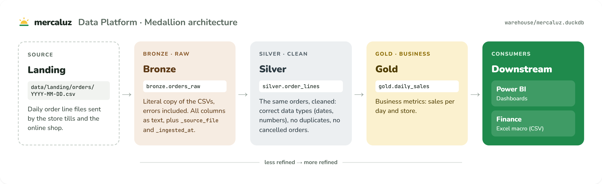

# Sesión 0 · Instalación y configuración

**Resultado:** el repositorio de Mercaluz con OpenSpec inicializado, integrado en Claude Code y con un `config.yaml` que describe la empresa.

---

## 0.1 Requisitos

| Herramienta | Versión mínima | Comprobación |
|---|---|---|
| Node.js | 20.19.0 | `node --version` |
| npm | La incluida con Node.js | `npm --version` |
| Python | 3.12 (fijada en `.python-version`; `uv sync` la descarga si no está instalada) | `uv python find` |
| uv | Cualquier versión reciente | `uv --version` |
| Git | Cualquier versión | `git --version` |
| Claude Code | La más reciente | `claude --version` (o la aplicación de escritorio) |

> **Terminales:** el taller funciona en Git Bash, macOS, Linux, PowerShell y cmd. La mayoría de los comandos (`git`, `uv`, `openspec`) son iguales en todos ellos. Cuando un comando cambia según el terminal, se indican las variantes.

### Instalar Node.js

OpenSpec se instala con npm, que se distribuye junto con Node.js. Si `node --version` devuelve un error o una versión inferior a la 20.19, instala la versión **LTS**:

**Windows** (PowerShell):

```powershell
winget install OpenJS.NodeJS.LTS
```

**macOS** (con Homebrew):

```bash
brew install node
```

**Linux** (también válido en macOS): con [nvm](https://github.com/nvm-sh/nvm), que instala Node.js en el usuario actual sin necesidad de `sudo`. Instala nvm según las instrucciones de su README y, a continuación, ejecuta:

```bash
nvm install --lts
```

También puedes usar el instalador gráfico de [nodejs.org](https://nodejs.org/) (opción *LTS*).

**Cierra y vuelve a abrir el terminal** para que reconozca los nuevos comandos, y comprueba la instalación:

```bash
node --version
```

```bash
npm --version
```

> **Windows con nvm-windows o Volta:** ambas opciones son válidas, siempre que `node --version` devuelva la 20.19 o una versión posterior.

## 0.2 Instalar el CLI de OpenSpec

Instalación global con npm (opción recomendada):

```bash
npm install -g @fission-ai/openspec@latest
```

Comprueba la instalación:

```bash
openspec --version
```

Alternativas:

| Opción | Comando | Cuándo usarla |
|---|---|---|
| Homebrew (macOS/Linux) | `brew install openspec` | Si gestionas las herramientas con Homebrew |
| Sin instalación | `npx @fission-ai/openspec@latest init` | Para pruebas puntuales o en CI |
| pnpm / yarn / bun | `pnpm add -g @fission-ai/openspec@latest` | Si es tu gestor de paquetes habitual |
| Versión fijada (equipos) | `npm install -g @fission-ai/openspec@1.14.1` | Para que todo el equipo y la CI usen la misma versión |

> **Windows, error "running scripts is disabled on this system":** PowerShell bloquea el script `openspec.ps1` que crea npm. Usa `openspec.cmd --version`, ejecuta los comandos desde Git Bash o solicita al administrador del equipo que habilite la política `RemoteSigned` para tu usuario.

### Telemetría

OpenSpec envía estadísticas anónimas (solo el nombre del comando y la versión). Muchas empresas exigen desactivarlas:

```bash
openspec config set telemetry.enabled false
```

También puede desactivarse con una variable de entorno (útil en CI): `OPENSPEC_TELEMETRY=0` o `DO_NOT_TRACK=1`.

## 0.3 Preparar la copia de trabajo del repositorio

Trabaja siempre sobre una **copia** del repositorio, para poder repetir el taller desde el principio. Desde la raíz de este taller, crea la carpeta `taller` en tu carpeta de usuario, copia el repositorio y sitúate en la copia:

**Git Bash, macOS y Linux:**

```bash
mkdir -p ~/taller
cp -r mercaluz-data-platform ~/taller/
cd ~/taller/mercaluz-data-platform
```

**PowerShell:**

```powershell
New-Item -ItemType Directory -Force "$HOME\taller"
Copy-Item -Recurse mercaluz-data-platform "$HOME\taller\"
Set-Location "$HOME\taller\mercaluz-data-platform"
```

**cmd:**

```bat
mkdir "%USERPROFILE%\taller"
xcopy mercaluz-data-platform "%USERPROFILE%\taller\mercaluz-data-platform\" /E /I /H
cd /d "%USERPROFILE%\taller\mercaluz-data-platform"
```

A continuación, inicializa Git en la copia (igual en todos los terminales):

```bash
git init
```

```bash
git add .
```

```bash
git commit -m "Initial state of Mercaluz Data Platform"
```

Instala las dependencias del proyecto:

```bash
uv sync
```

El repositorio todavía no contiene ningún pipeline: solo los datos de entrada, la configuración de Python y `query.py`, un script para consultar el warehouse. Comprueba que funciona; como aún no existe el warehouse, debe indicarlo:

```bash
uv run python query.py gold.daily_sales
```

```
The warehouse does not exist yet. Run: uv run python run_pipeline.py --all
```

`run_pipeline.py` no existe todavía: lo creará la IA en la sesión 1.

## 0.4 Conceptos básicos de datos

Este apartado presenta los conceptos de datos necesarios para seguir el taller y lo que se va a construir. Si ya conoces la arquitectura medallion, puedes pasar directamente a "Los datos de entrada".

### Qué es un pipeline de datos

Un **pipeline** es un programa que recoge datos en bruto (en este caso, los ficheros CSV de pedidos que envían las cajas y la tienda online) y los transforma, paso a paso, hasta dejarlos preparados para otros equipos.

Los datos se almacenarán en **DuckDB**, una base de datos SQL contenida en un único fichero (`warehouse/mercaluz.duckdb`) que no requiere servidor. Es similar a SQLite, pero está orientada al análisis de datos. Se consulta con SQL estándar (`SELECT`, `WHERE`, `GROUP BY`) desde Python.

### Las tres capas: bronze, silver y gold



La **arquitectura medallion** organiza los datos en tres capas, de menor a mayor elaboración. Cada capa es un *schema* de la base de datos (un grupo de tablas); por eso el nombre completo de cada tabla tiene la forma `capa.tabla`:

| Capa | Tabla en Mercaluz | Contenido | Usuarios | Sesión |
|---|---|---|---|---|
| **bronze** | `bronze.orders_raw` | Copia **literal** de los CSV, errores incluidos. Todas las columnas como texto, más el fichero de origen de cada fila (`_source_file`) y el momento de la carga (`_ingested_at`) | Solo el equipo de datos, para reprocesar y auditar | 1 |
| **silver** | `silver.order_lines` | Los mismos pedidos ya **depurados**: con tipos de datos correctos (fechas, números), sin duplicados y sin pedidos cancelados | Analistas y otras transformaciones | 2 |
| **gold** | `gold.daily_sales` | **Indicadores de negocio**: ventas por día y tienda | Power BI (cuadros de mando) | 3 |

El último paso es el **export** (sesión 4): un fichero CSV generado a partir de gold para la macro de Excel de Finanzas.

> **Principio fundamental:** bronze conserva los datos tal como se recibieron, sin corregirlos. Si se produce un error en silver o en gold, ambas capas pueden reconstruirse a partir de bronze.

### Los datos de entrada

Cada fichero de `data/landing/orders/` contiene las líneas de pedido de un día. Este es `2026-10-01.csv`:

```
order_id,order_ts,store_id,customer_email,product_sku,category,quantity,unit_price,status
O-1001,2026-10-01T09:12:00,MAD-001,ana.garcia@example.com,SKU-LECHE-1L,alimentacion_basica,6,0.95,completed
O-1001,2026-10-01T09:12:00,MAD-001,ana.garcia@example.com,SKU-ACEITE-1L,alimentacion,1,8.49,completed
O-1002,2026-10-01T10:05:00,MAD-001,luis.perez@example.com,SKU-DETERG-3L,drogueria,1,11.90,completed
O-1003,2026-10-01T11:30:00,BCN-014,marta.soler@example.com,SKU-PAN-BARRA,alimentacion_basica,2,0.80,completed
O-1003,2026-10-01T11:30:00,BCN-014,marta.soler@example.com,SKU-PAN-BARRA,alimentacion_basica,2,0.80,completed
O-1004,2026-10-01T12:45:00,BCN-014,jordi.vila@example.com,SKU-VINO-75CL,bebidas,3,6.50,returned
O-1005,2026-10-01T13:10:00,VLC-007,carmen.ruiz@example.com,SKU-AGUA-6X1.5L,alimentacion,2,2.70,cancelled
,2026-10-01T14:00:00,VLC-007,sin.pedido@example.com,SKU-FRUTA-KG,alimentacion_basica,1,1.99,completed
O-1006,2026-10-01T15:20:00,VLC-007,pablo.martin@example.com,SKU-CAFE-250G,alimentacion,-2,3.75,completed
O-1007,2026-10-01T18:40:00,MAD-001,elena.diaz@example.com,SKU-CERV-6PK,bebidas,1,abc,completed
```

Antes de construir nada, conviene observar los datos. Un pedido puede tener varias líneas (O-1001), y el fichero incluye casos que el pipeline tendrá que resolver:

| Línea | Particularidad |
|---|---|
| O-1003 | Aparece dos veces, idéntica |
| O-1004 | Es una devolución (`returned`) |
| O-1005 | Es un pedido cancelado (`cancelled`) |
| Línea sin `order_id` | Falta el identificador del pedido |
| O-1006 | Cantidad negativa (`-2`) |
| O-1007 | Precio no numérico (`abc`) |

Cada sesión decide, en la spec, qué hacer con algunos de estos casos. Los que ninguna spec contemple quedarán como estén, y eso también tendrá consecuencias.

### Plan de construcción

| Sesión | Qué se construye | Cómo se comprueba |
|---|---|---|
| 1 | Carga de los CSV en bronze | `query.py` muestra las 10 líneas del 1 de octubre |
| 2 | Líneas de pedido depuradas en silver | Quedan 6 líneas del 1 de octubre |
| 3 | Ventas diarias por tienda en gold | MAD-001 vende 26,09 € el 1 de octubre |
| 4 | Fichero para Finanzas | El CSV contiene `2026-10-01;MAD-001;2;26,09` |
| 5 | Reglas de calidad y cuarentena | Desaparecen las ventas negativas |
| 6 | Reprocesar un día sin duplicar | Bronze no crece al repetir una carga |
| 7 y 8 (avanzadas) | Métricas sin IVA; protección de datos personales | Ventas netas de 23,03 €; sin emails en silver |

### Otros términos del taller

| Término | Definición | Sesión |
|---|---|---|
| **Consumidor** (*downstream*) | Equipo, informe o programa que utiliza tus datos. Un cambio en una tabla puede afectarle sin que el equipo de datos lo detecte | Todas |
| **Contrato de datos** | Compromiso con los consumidores: qué columnas existen, qué significan y cómo se comunican los cambios | 4 y 7 |
| **Cuarentena** | Tabla que almacena las filas que no superan los controles de calidad, junto con el motivo | 5 |
| **Idempotencia** | Propiedad de un proceso que produce el mismo resultado tanto si se ejecuta una vez como varias | 6 |
| **Datos personales (PII)** | Datos que identifican a una persona, como el email. El RGPD obliga a protegerlos | 8 |

El [glosario](../appendix/glossary.md) recoge estos y otros términos.

## 0.5 `openspec init`

En la raíz del repositorio, inicializa OpenSpec con **una** de estas dos opciones (no ejecutes ambas):

**Opción A (recomendada), modo no interactivo:**

```bash
openspec init --tools claude --language es
```

**Opción B, asistente interactivo:**

```bash
openspec init
```

El asistente pregunta qué herramientas de IA se van a utilizar; selecciona **Claude Code**.

> **Error "--language does not overwrite an existing OpenSpec config":** aparece al ejecutar `openspec init --language es` en un repositorio que ya tiene `openspec/config.yaml`, por ejemplo después de la opción B. No es necesario repetir la inicialización: el idioma se fija en el campo `context` del `config.yaml` que se configura en el apartado 0.8 (líneas `Language: es` y `All artifacts must be written in es.`). Continúa en el apartado 0.6.

| Opción | Función |
|---|---|
| `--tools claude` | Genera los comandos y skills para Claude Code. Admite una lista (`claude,cursor,github-copilot`) o `all` |
| `--language es` | Los artefactos se redactan en español (los encabezados estructurales y `SHALL`/`MUST` se mantienen en inglés para que el analizador los reconozca) |
| `--profile core` | Conjunto de workflows que se instalan (ver 0.7) |

### Ficheros generados

```
mercaluz-data-platform/
├── openspec/
│   ├── config.yaml              ← configuración del proyecto (se personaliza en 0.8)
│   ├── specs/                   ← fuente de verdad: comportamiento ACTUAL del sistema
│   └── changes/
│       └── archive/             ← changes implementados y archivados
└── .claude/
    ├── commands/opsx/           ← comandos /opsx:* para Claude Code
    │   ├── propose.md  apply.md  archive.md
    │   ├── explore.md  update.md  sync.md
    └── skills/                  ← las mismas capacidades en forma de skills
        ├── openspec-propose/  openspec-apply-change/  openspec-archive-change/
        ├── openspec-explore/  openspec-update-change/  openspec-sync-specs/
```

> Incluye en el commit **todos** los ficheros, también `.claude/`, para que todo el equipo disponga de los mismos comandos.

```bash
git add .
```

```bash
git commit -m "Initialize OpenSpec"
```

## 0.6 Comprobar la integración con Claude Code

Abre Claude Code en la carpeta del repositorio y escribe `/opsx`. Deben aparecer estos comandos:

| Comando | Función |
|---|---|
| `/opsx:explore` | Analizar un problema con la IA, sin escribir código |
| `/opsx:propose <idea>` | Crear un change con todos sus artefactos (proposal, specs, design, tasks) |
| `/opsx:update` | Revisar los artefactos de un change existente y mantenerlos coherentes |
| `/opsx:apply` | Implementar las tareas del change |
| `/opsx:sync` | Incorporar los deltas de un change a las specs principales sin archivarlo |
| `/opsx:archive` | Cerrar el change: fusiona los deltas en `openspec/specs/` y lo mueve a `archive/` |

> En otras herramientas el nombre del comando varía: `/opsx-propose` (Cursor, Copilot), `$openspec-propose` (Codex), etc. `openspec init` indica la forma correcta en cada caso.

## 0.7 Perfiles de workflow

El perfil `core` (predeterminado) instala los 6 comandos anteriores. El perfil **ampliado** añade los siguientes:

| Comando | Función |
|---|---|
| `/opsx:new` | Crear un change vacío y generar los artefactos de uno en uno |
| `/opsx:continue` | Generar el siguiente artefacto pendiente |
| `/opsx:ff` | *Fast-forward*: generar todos los artefactos pendientes en un solo paso |
| `/opsx:verify` | Comprobar que la implementación cumple las specs |
| `/opsx:bulk-archive` | Archivar varios changes a la vez |
| `/opsx:onboard` | Tutorial guiado dentro del propio repositorio |

> **Recomendación para el taller:** utiliza el perfil `core`, que es suficiente para todas las sesiones. El perfil ampliado se describe en el anexo [OpenSpec en equipo](../appendix/openspec-in-teams.md); actívalo solo si quieres probar esos comandos.

### Cómo activar el perfil ampliado

La configuración de perfiles es **global**: se guarda en `%APPDATA%\openspec\config.json` en Windows o en `~/.config/openspec/config.json` en macOS y Linux, y afecta a todos los proyectos. Se modifica en dos pasos.

**Paso 1. Seleccionar los workflows.** En la raíz del repositorio de trabajo, ejecuta:

```bash
openspec config profile
```

El comando muestra la configuración actual y un menú con cuatro opciones. Muévete con las flechas y confirma con Intro:

| Opción del menú | Qué hace |
|---|---|
| `Change delivery + workflows` | Cambia el formato de instalación (comandos, skills o ambos) y los workflows |
| `Change delivery only` | Cambia solo el formato de instalación |
| **`Change workflows only`** | **Cambia solo los workflows. Es la opción que hay que elegir** |
| `Keep current settings (exit)` | Sale sin guardar cambios |

Al elegir `Change workflows only` aparece una lista de workflows; los marcados con `[x]` están activos. Marca o desmarca cada uno con la barra espaciadora, activa `new`, `continue`, `ff`, `verify`, `bulk-archive` y `onboard` sin desactivar los seis del perfil `core`, y confirma con Intro.

**Paso 2. Aplicar los cambios al proyecto.** La configuración global no modifica los ficheros del proyecto hasta que se aplica. Si el comando anterior pregunta `Apply changes to this project now?`, responde que sí. Si no lo pregunta, o respondiste que no, ejecuta:

```bash
openspec update
```

`openspec update` regenera los ficheros de `.claude/` con los workflows seleccionados. Para que Claude Code reconozca los comandos nuevos, reinicia la sesión de Claude Code e incluye los ficheros regenerados en un commit.

Para volver al perfil `core` sin pasar por el menú:

```bash
openspec config profile core
```

```bash
openspec update
```

> Si necesitas salir del menú sin guardar, pulsa Ctrl+C.

## 0.8 Personalizar `openspec/config.yaml`

Es **el fichero más importante del taller**: su contenido se incluye en *todas* las instrucciones que OpenSpec envía a la IA. Tiene tres bloques:

| Clave | Contenido | Equivalente en un equipo |
|---|---|---|
| `context` | Texto libre sobre el proyecto: empresa, tecnologías, arquitectura y convenciones | La documentación de incorporación de una persona nueva |
| `rules.<artefacto>` | Reglas adicionales para `proposal`, `specs`, `design` o `tasks` | La lista de comprobación de las revisiones |
| `operations.apply/archive.guidance` | Indicaciones para implementar y archivar | La *definition of done* |

Sustituye el `config.yaml` generado por la siguiente versión. La forma más segura es copiar el fichero de la solución, desde la raíz de este taller (ajusta la ruta de destino si tu copia de trabajo está en otra carpeta):

**Git Bash, macOS y Linux:**

```bash
cp solutions/session-00/openspec/config.yaml ~/taller/mercaluz-data-platform/openspec/config.yaml
```

**PowerShell:**

```powershell
Copy-Item solutions\session-00\openspec\config.yaml "$HOME\taller\mercaluz-data-platform\openspec\config.yaml"
```

**cmd:**

```bat
copy /Y solutions\session-00\openspec\config.yaml "%USERPROFILE%\taller\mercaluz-data-platform\openspec\config.yaml"
```

Si prefieres copiar y pegar el contenido, incluye el bloque **completo**, desde la primera línea (`schema: spec-driven`), y respeta la sangría. YAML depende de ella: si falta la línea `context: |` o cambian los espacios, OpenSpec muestra `Warning: could not parse … config.yaml` e **ignora el fichero entero**, de modo que la IA no recibe ni el contexto ni las reglas.

```yaml
schema: spec-driven

context: |
  Language: es
  All artifacts must be written in es.
  Keep OpenSpec structural headings and SHALL/MUST keywords in English.

  Empresa: Mercaluz, cadena española de supermercados (120 tiendas y venta online).
  Equipo: Data Platform (6 personas). Partes interesadas: Finanzas, BI (Power BI), DPO/Legal, Operaciones.
  Proyecto: pipeline diario de pedidos con arquitectura medallion, que se construye paso a paso.
    landing (CSV diarios en data/landing/orders/YYYY-MM-DD.csv)
    -> bronze (copia literal, todo VARCHAR + _source_file, _ingested_at)
    -> silver (tipado y limpio)
    -> gold (agregados de negocio que consume Power BI)
    -> exports (ficheros para otros equipos)
  Stack local: Python 3.12, DuckDB, uv, pytest y rich (salida por consola). En producción: Databricks + Airflow.
  Estructura del código:
    - Paquete mercaluz/ con config.py (rutas y conexión) y un subpaquete por etapa: ingestion/, transform/, exports/.
    - Warehouse DuckDB en warehouse/mercaluz.duckdb, con los schemas bronze, silver y gold.
    - Punto de entrada run_pipeline.py con --date YYYY-MM-DD y --all; muestra una línea por paso con rich,
      por ejemplo "[bronze] 2026-10-01: 10 rows loaded".
    - Tests con pytest en tests/, sobre una copia de los ficheros de landing y un warehouse temporal.
    - Código, identificadores y mensajes en inglés.
  Convenciones de datos:
    - Tablas <capa>.<entidad_snake_case>; columnas técnicas con prefijo "_".
    - Importes DECIMAL(12,2) en EUR; timestamps en UTC sin zona horaria.
    - Fecha de negocio = order_date (YYYY-MM-DD).
  Datos personales (RGPD): customer_email es dato personal.

rules:
  proposal:
    - Enumera las tablas/columnas y los consumidores downstream (BI, Finanzas, exports) afectados
    - Marca como **BREAKING** cualquier cambio de esquema en gold o en exports
  specs:
    - Los escenarios usan datos concretos (fechas, pedidos, store_id, importes) para poder convertirse en tests
    - Especifica el comportamiento ante datos inválidos y ficheros ausentes
    - No nombres funciones, módulos ni librerías de Python en las specs
    - Pon a requisitos y escenarios nombres neutros que sigan siendo válidos si el comportamiento cambia
    - Incluye solo los requisitos que pide la propuesta, uno por comportamiento solicitado y con sus detalles (columnas, tipos, formatos) dentro del mismo requisito; no añadas requisitos que no se hayan pedido
  design:
    - Si el cambio afecta a las cargas, explica idempotencia y rollback
    - Compara al menos dos alternativas en cada decisión relevante
  tasks:
    - Cada tarea indica cómo verificarla (test de pytest o comando uv run)
    - Usa los ficheros de data/landing/orders como datos de prueba
    - Incluye los tests en cada grupo de tareas, no en un grupo final

operations:
  apply:
    guidance:
      - Implementa solo lo que piden las specs; no añadas validaciones ni comportamientos que no estén especificados
      - Ejecuta uv run pytest al terminar cada grupo de tareas y no marques la tarea si falla
      - En SQL, pasa los valores como parámetros (?) y nunca con f-strings; los nombres de tablas y columnas solo pueden salir de constantes del código
  archive:
    guidance:
      - Sincroniza siempre las specs delta con las specs principales al archivar (nunca archives sin sincronizar)
      - Antes de archivar, resume qué tablas o ficheros cambiaron de esquema
```

### Justificación del contexto y las reglas

- **"Estructura del código" (en `context`):** el pipeline lo escribe la IA. Si el contexto no fija dónde va cada pieza (paquete, warehouse, punto de entrada, tests), cada change podría organizar el código de una forma distinta. Con estas convenciones, el código de todos los participantes se parece y las guías son válidas para todos.
- **"Implementa solo lo que piden las specs":** la IA tiende a añadir validaciones "por si acaso". Si lo hace, el comportamiento del sistema deja de estar documentado en las specs. Esta regla mantiene una correspondencia exacta entre specs y código, y permite comprobar en el taller qué ocurre con los casos que ninguna spec contempla.
- **"Consumidores downstream":** en Data Engineering, el riesgo principal no está en el propio código, sino en quién utiliza sus resultados.
- **"Escenarios con datos concretos":** `total_amount = 26,09` se traduce directamente en un `assert`; "el importe es correcto" no.
- **"Datos inválidos y ficheros ausentes":** son los casos que generan más incidencias en producción.
- **"No nombrar funciones en las specs":** las specs describen comportamiento observable; los detalles de implementación corresponden a `design.md`.
- **"Nombres neutros":** los requisitos se modifican con el tiempo. Un requisito llamado "Descarte silencioso de filas" tendría que renombrarse cuando las filas dejen de descartarse en silencio; "Tratamiento de filas inválidas" sigue siendo válido.
- **"Incluye solo los requisitos que pide la propuesta":** sin esta regla, la IA tiende a convertir cada detalle en un requisito y a añadir comportamientos que nadie ha pedido. Las specs crecen, cuestan más de revisar y anticipan decisiones que corresponden a otros changes.
- **"Sincroniza siempre las specs al archivar":** al archivar, las specs del change deben pasar a `openspec/specs/`. Si se archiva sin sincronizar, la spec principal no se crea y los changes posteriores no encuentran los requisitos que modifican.
- **"Valores SQL como parámetros":** previene la **inyección SQL**. El pipeline incorpora a sus consultas datos de origen externo, como el nombre del fichero que envía el sistema de cajas. Si ese valor se insertara en la consulta mediante un f-string, un nombre con una comilla (`'`) provocaría un error o, en el peor caso, alteraría el comportamiento de la consulta. Con `?`, DuckDB lo trata siempre como un valor:

```python
con.execute(f"DELETE FROM bronze.orders_raw WHERE _source_file = '{name}'")    # Incorrecto: inyección SQL
con.execute("DELETE FROM bronze.orders_raw WHERE _source_file = ?", [name])     # Correcto: parámetro
```

### Comprobar que el contexto llega a la IA

```bash
openspec new change config-test
```

```bash
openspec instructions specs --change config-test
```

El contexto aparece dentro de `<project_context>` y las reglas de specs dentro de `<rules>`: es exactamente la información que recibe Claude. A continuación, elimina el change de prueba:

**Git Bash, macOS y Linux:**

```bash
rm -rf openspec/changes/config-test
```

**PowerShell:**

```powershell
Remove-Item -Recurse -Force openspec\changes\config-test
```

**cmd:**

```bat
rmdir /s /q openspec\changes\config-test
```

```bash
git add .
```

```bash
git commit -m "Configure OpenSpec for Mercaluz"
```

## 0.9 Mantener OpenSpec actualizado

```bash
npm install -g @fission-ai/openspec@latest
```

```bash
openspec update
```

`openspec update` se ejecuta **en cada proyecto** y regenera los comandos y skills con la nueva versión. Incluye el resultado en un commit.

---

## Lista de comprobación final

- [ ] `openspec --version` devuelve la versión instalada
- [ ] `uv sync` termina sin errores y `query.py` indica que el warehouse todavía no existe
- [ ] Puedes explicar qué contendrán bronze, silver y gold, y qué particularidades tiene el fichero `2026-10-01.csv`
- [ ] Existen `openspec/` y `.claude/commands/opsx/`
- [ ] `/opsx:propose` aparece en Claude Code
- [ ] `config.yaml` contiene el contexto de Mercaluz y `openspec instructions` lo muestra
- [ ] Todos los cambios están incluidos en un commit

**Siguiente:** [Sesión 1 · Primer change: cargar los pedidos en bronze](01-bronze-ingestion.md)
